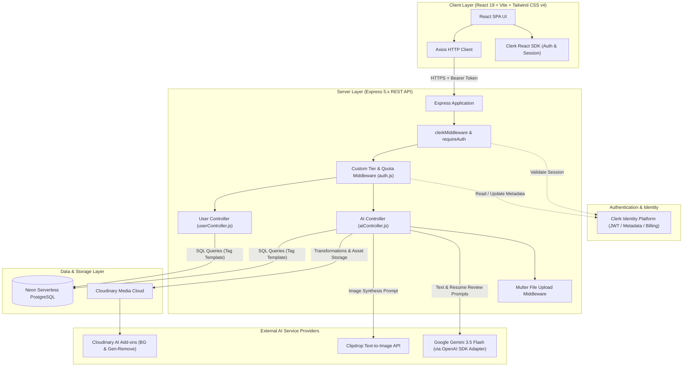
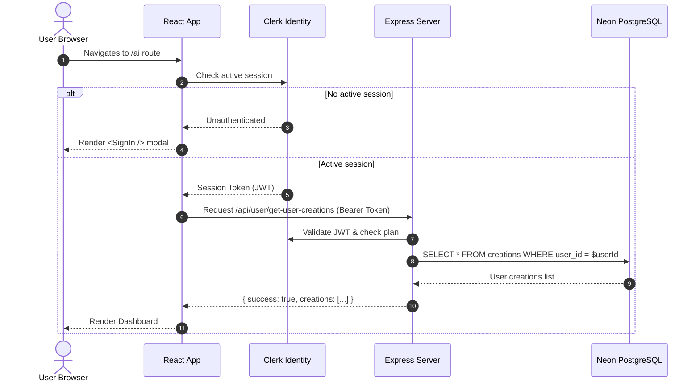
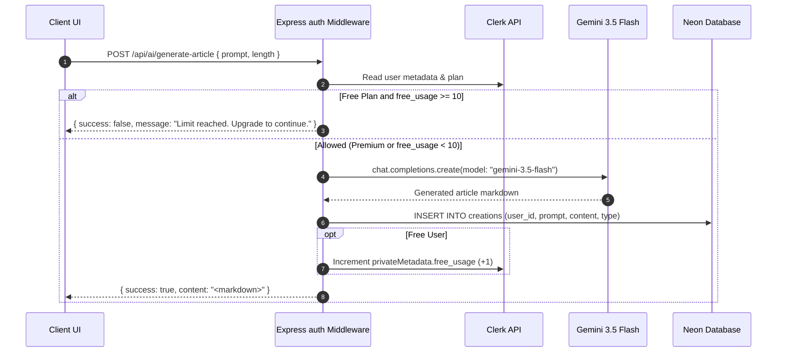

# QuickAI System Architecture

This document provides a comprehensive technical overview of the architecture, design patterns, component interactions, and data flows of the **QuickAI** platform.

---

## 1. Architectural Overview

QuickAI is designed as a decoupled, multi-tier software-as-a-service (SaaS) application composed of a client-side Single Page Application (SPA), a stateless Express.js REST API server, serverless PostgreSQL storage, and specialized external AI and media processing services.



---

## 2. Multi-Tier Architecture Breakdown

### 2.1 Client Tier (`/client`)
- **Framework & Tooling**: Built with **React 19** and bundled with **Vite 8**, utilizing modern ECMAScript modules.
- **Styling**: **Tailwind CSS v4** using the `@tailwindcss/vite` plugin and custom CSS variable design tokens (`--color-primary: #5044E5`).
- **Routing**: **React Router DOM v7** manages client-side navigation:
  - Public route: `/` (Landing page with Hero, AI Tools showcase, Testimonials, Pricing table, and Footer).
  - Protected layout: `/ai` (Wraps Dashboard, Tool interfaces, and Community feed with authentication guarding).
- **State & Identity**: **Clerk React SDK** handles authentication tokens, session refreshes, user profiles, and plan-based component protection via `<Protect plan="premium">`.
- **Content Rendering**: **React Markdown** renders structured AI markdown outputs (headers, lists, bold formatting) cleanly with CSS resetting (`reset-tw`).
- **Feedback**: **React Hot Toast** displays non-blocking toast notifications for API responses and errors.

### 2.2 Server Tier (`/server`)
- **Runtime**: **Node.js** running **Express 5.x** with native ES Module (`"type": "module"`) syntax.
- **Middlewares**:
  - `cors()`: Cross-Origin Resource Sharing enablement for client requests.
  - `express.json()`: JSON payload parser.
  - `clerkMiddleware()`: Attaches session inspection functions to `req.auth()`.
  - `requireAuth()`: Enforces authentication across all API routes under `/api/*`.
  - `auth` (`server/middlewares/auth.js`): Inspects subscription tiers, updates user metadata, and manages free-tier generation quotas.
  - `upload` (`server/configs/multer.js`): Multer disk storage handler for handling multipart form file uploads (images and PDF resumes).
- **Controllers**:
  - `aiController.js`: Dispatches tasks to Gemini, Clipdrop, Cloudinary, and PDF parsers.
  - `userController.js`: Manages user creations, public community creations, and like toggles.

### 2.3 Data & Storage Tier
- **Relational Storage**: **Neon Serverless PostgreSQL** connected through `@neondatabase/serverless` using HTTP/WebSocket over WebSockets/SSL.
- **Asset Storage & Processing**: **Cloudinary** stores generated and processed visual assets, offloading binary storage from the PostgreSQL database.

---

## 3. End-to-End Execution Flows

### 3.1 Authentication & Authorization Pipeline



### 3.2 Text Generation Workflow (Articles & Blog Titles)

1. **Client Action**: The user inputs a topic and selects an article length or blog category, then clicks Generate.
2. **Token Extraction**: The client requests a current JWT token via `await getToken()` from Clerk.
3. **Payload Dispatch**: An HTTP POST request is sent to `/api/ai/generate-article` or `/api/ai/generate-blog-title`.
4. **Auth & Quota Inspection**:
   - `auth` middleware verifies whether the user holds a `premium` plan.
   - If `free`, the system verifies whether `free_usage < 10`. If the limit is reached, a `403`/error response is returned (`"Limit reached. Upgrade to continue."`).
5. **AI Execution**:
   - Token limits are dynamically calculated (Short: 3000 tokens, Medium: 4000 tokens, Long: 5000 tokens).
   - An OpenAI client configured with the Google Generative Language endpoint (`https://generativelanguage.googleapis.com/v1beta/openai/`) invokes `gemini-3.5-flash`.
6. **Persistence**:
   - An entry is inserted into the `creations` table with `type: 'article'` or `'blog_title'`.
   - If the user is on the free plan, Clerk user `privateMetadata.free_usage` is incremented.
7. **Client Rendering**: The markdown text is returned to the client and rendered using `react-markdown`.



### 3.3 Visual Media Generation & Transformation Workflows

#### A. AI Text-to-Image Generation
1. Route: `POST /api/ai/generate-image` (Requires `premium` plan).
2. The server forms a `FormData` object with the user prompt and sends an authorized request to `https://clipdrop-api.co/text-to-image/v1` with `responseType: "arraybuffer"`.
3. The binary response is converted to a base64 Data URI (`data:image/png;base64,...`).
4. The image is uploaded to Cloudinary (`cloudinary.uploader.upload`), which yields a permanent HTTPS `secure_url`.
5. An entry is saved into `creations` with `type: 'image'` and optional `publish: true|false`.
6. The client receives `secure_url` and displays the image.

#### B. AI Background Removal
1. Route: `POST /api/ai/remove-image-background` (Requires `premium` plan).
2. Multer intercepts the multipart file upload (`image`) and saves it temporarily to local disk.
3. The server sends the file path to Cloudinary with transformation instructions:
   ```javascript
   {
       transformation: [{
           effect: 'background_removal',
           background_removal: 'remove_the_background'
       }]
   }
   ```
4. Cloudinary applies the background removal AI model and hosts the isolated PNG.
5. The result URL is recorded in Neon DB and returned to the client.

#### C. AI Object Removal
1. Route: `POST /api/ai/remove-image-object` (Requires `premium` plan).
2. The user submits an image file and the name of a single object (e.g., `"spoon"`).
3. The image is uploaded to Cloudinary to generate a unique `public_id`.
4. A transformed URL is dynamically constructed:
   ```javascript
   cloudinary.url(public_id, {
       transformation: [{ effect: `gen_remove:${object}` }],
       resource_type: 'image'
   })
   ```
5. Cloudinary processes generative inpainting on-the-fly upon URL access.
6. The URL is stored in `creations` and returned to the frontend.

### 3.4 Resume Review Workflow

1. Route: `POST /api/ai/resume-review` (Requires `premium` plan).
2. Multer processes the multipart file upload (`resume`).
3. File size is checked (`resume.size <= 5MB`).
4. The file buffer is parsed into raw text using `pdf-parse`.
5. A structured prompt is synthesized:
   `"Review the following resume and provide constructive feedback on its strengths, weaknesses, and areas for improvement. Resume Content:\n\n${pdfData.text}"`
6. Sent to `gemini-3.5-flash` with `max_tokens: 4000`.
7. Output analysis is persisted in the database with `type: 'resume_review'` and returned to the frontend.

---

## 4. Key Architectural Decisions

| Decision | Implementation | Justification |
|---|---|---|
| **Decoupled Architecture** | Independent `client` and `server` folders | Enables independent scaling, hosting separation (e.g., Vercel for SPA, Render for API), and clear boundary of concerns. |
| **Serverless Database** | `@neondatabase/serverless` over standard pool | Eliminates persistent connection overhead in serverless/container environments; auto-scales and provides fast query response. |
| **OpenAI Adapter for Gemini** | `new OpenAI({ baseURL: "https://generativelanguage.../openai/" })` | Leverages standardized OpenAI client libraries while benefiting from Gemini 3.5 Flash pricing, context window, and performance. |
| **Cloudinary Generative AI** | Cloudinary URL Transformations (`gen_remove`, `background_removal`) | Avoids self-hosting complex computer vision pipelines or multi-gigabyte models; leverages edge CDN distribution. |
| **Clerk Native Metadata** | `user.privateMetadata.free_usage` | Removes the need for separate user tables or Redis quota stores; user state and subscription entitlement remain synchronized within the auth provider. |
