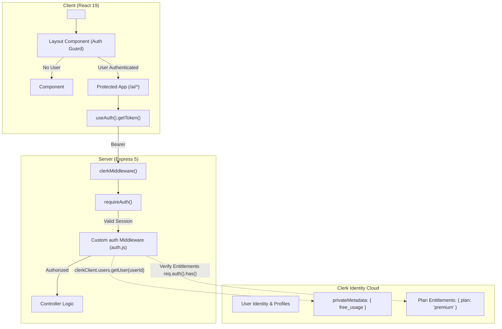

# QuickAI Authentication & Security

This document details the identity architecture, authentication flows, route protection, token lifecycle, and tier-based authorization policies implemented in **QuickAI**.

---

## 1. Authentication Architecture

QuickAI integrates **Clerk** as its complete identity provider and subscription management engine. Clerk secures both the client-side Single Page Application and the Node.js Express API.



---

## 2. Client-Side Authentication (`client`)

### 2.1 Provider Configuration (`client/src/main.jsx`)
The application is wrapped with `<ClerkProvider>` at the root, passing the publishable key from environment variables:

```jsx
import { ClerkProvider } from '@clerk/clerk-react'

createRoot(document.getElementById('root')).render(
  <ClerkProvider publishableKey={import.meta.env.VITE_CLERK_PUBLISHABLE_KEY}>
    <BrowserRouter>
      <App />
    </BrowserRouter>
  </ClerkProvider>
)
```

### 2.2 Route Guarding (`client/src/pages/Layout.jsx`)
All routes under `/ai` (Dashboard, tools, community) are protected by a top-level session verification:

```jsx
const Layout = () => {
  const { user } = useUser()
  
  return user ? (
    <div className='flex flex-col h-screen'>
      {/* Protected Navigation and Outlet */}
    </div>
  ) : (
    <div className='flex items-center justify-center h-screen'>
      <SignIn />
    </div>
  )
}
```

### 2.3 UI Tier-Based Rendering (`<Protect>`)
The client dynamically adapts UI elements based on the user's active billing plan:
- In `client/src/pages/Dashboard.jsx` and `client/src/components/Sidebar.jsx`:
  ```jsx
  <Protect plan="premium" fallback="Free">
    Premium
  </Protect>
  ```

### 2.4 Authenticated API Requests
All backend calls retrieve the active session JWT token using the Clerk `useAuth` hook and inject it into the `Authorization` header:

```javascript
const { getToken } = useAuth();

const { data } = await axios.post('/api/ai/generate-article', payload, {
  headers: {
    Authorization: `Bearer ${await getToken()}`
  }
});
```

---

## 3. Server-Side Authentication & Authorization (`server`)

### 3.1 Global Authentication Middleware (`server/server.js`)
Express mounts Clerk's middleware globally:

```javascript
import { clerkMiddleware, requireAuth } from '@clerk/express'

// Attaches auth session helper to req.auth()
app.use(clerkMiddleware());

// Public health check route
app.get('/', (req, res) => res.send('Server is Live!'));

// Enforces valid Clerk session on all following routes
app.use(requireAuth());

// Protected route groups
app.use('/api/ai', aiRouter);
app.use('/api/user', userRouter);
```

Any unauthenticated request to `/api/*` is rejected automatically by `requireAuth()`.

---

## 4. Custom Tier & Quota Authorization Middleware (`server/middlewares/auth.js`)

QuickAI enforces a custom tier-verification and usage-tracking middleware before reaching any controller:

```javascript
import { clerkClient } from "@clerk/express";

export const auth = async (req, res, next) => {
    try {
        const { userId, has } = await req.auth();
        const hasPremiumPlan = await has({ plan: 'premium' });

        const user = await clerkClient.users.getUser(userId);

        if (!hasPremiumPlan && user.privateMetadata.free_usage) {
            req.free_usage = user.privateMetadata.free_usage;
        } else {
            await clerkClient.users.updateUserMetadata(userId, {
                privateMetadata: {
                    free_usage: 0
                }
            })
            req.free_usage = 0;
        }

        req.plan = hasPremiumPlan ? 'premium' : 'free';
        next();
    } catch (error) {
        res.json({ success: false, message: error.message });
    }
};
```

### 4.1 How It Works
1. **Plan Identification**: `has({ plan: 'premium' })` interrogates Clerk's billing and organization claims to detect whether the user has subscribed to the `premium` plan.
2. **User Metadata Retrieval**: Fetches the user record from Clerk via `clerkClient.users.getUser(userId)`.
3. **Usage Initialization**: If the user does not have a recorded `free_usage` counter, it initializes `user.privateMetadata.free_usage = 0`.
4. **Context Enrichment**: Attaches `req.plan` (`'premium'` or `'free'`) and `req.free_usage` to the Express request object for downstream controllers.

---

## 5. Tier Access Matrix & Quota Rules

| Feature / Endpoint | Free Tier Policy | Premium Tier Policy |
|---|---|---|
| **User Dashboard** | Full access to own creations | Full access |
| **Community Feed & Likes** | View all & like creations | View all & like creations |
| **AI Article Writer** | Max 10 lifetime generations (shared with Blog Titles) | **Unlimited** |
| **Blog Title Generator** | Max 10 lifetime generations (shared with Articles) | **Unlimited** |
| **AI Image Generator** | **Forbidden** (Requires upgrade) | **Unlimited** |
| **Background Removal** | **Forbidden** (Requires upgrade) | **Unlimited** |
| **Object Removal** | **Forbidden** (Requires upgrade) | **Unlimited** |
| **Resume Reviewer** | **Forbidden** (Requires upgrade) | **Unlimited** |

### 5.1 Quota Enforcement in Text Controllers
When generating an article or blog title:
```javascript
if (plan !== 'premium' && free_usage >= 10) {
    return res.json({
        success: false,
        message: "Limit reached. Upgrade to continue."
    });
}
```
Upon successful generation, the user's metadata is incremented:
```javascript
if (plan !== 'premium') {
    await clerkClient.users.updateUserMetadata(userId, {
        privateMetadata: {
            free_usage: free_usage + 1
        }
    });
}
```

### 5.2 Premium Gate in Media & Document Controllers
For premium-exclusive endpoints (`generateImage`, `removeImageBackground`, `removeImageObject`, `resumeReview`):
```javascript
if (plan !== 'premium') {
    return res.json({
        success: false,
        message: "This feature is for premium users only. Please upgrade to access it."
    });
}
```

---

## 6. Security Best Practices Observed

1. **Zero Secret Leaks**: No secret keys (`CLERK_SECRET_KEY`, `GEMINI_API_KEY`, etc.) are exposed to the client. The client exclusively holds `VITE_CLERK_PUBLISHABLE_KEY`.
2. **Short-Lived JWT Tokens**: Session tokens issued by Clerk are short-lived and cryptographically verified on the backend.
3. **SQL Injection Mitigation**: All SQL queries in `aiController.js` and `userController.js` are constructed using tagged template literals provided by `@neondatabase/serverless`, which parameterize all values.
4. **File Size Boundaries**: Resume PDF uploads are bounded by `resume.size > 5 * 1024 * 1024` (5MB ceiling) to prevent memory exhaustion.
5. **No Password Storage in Database**: Passwords, OAuth federations, and password reset workflows are delegated entirely to Clerk, ensuring compliance with data protection standards.
