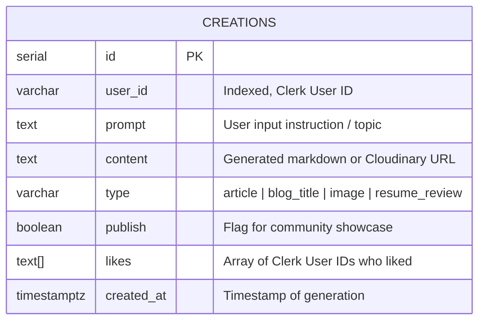

# QuickAI Database Design

This document details the database architecture, schema definitions, query access patterns, and design decisions for the **QuickAI** application.

---

## 1. Database Architecture Overview

QuickAI uses **Neon Serverless PostgreSQL** as its primary relational datastore. The application interacts with PostgreSQL using `@neondatabase/serverless`, which sends SQL queries over HTTP/WebSocket connections.



---

## 2. Table Schema: `creations`

The core table within QuickAI is `creations`. It stores all outputs generated by the various AI tools (text, visual, and analytical).

| Column Name | Data Type | Nullable | Default | Description |
|---|---|---|---|---|
| `id` | `SERIAL` / `INT` | No | Auto-incrementing | Primary key uniquely identifying each creation. |
| `user_id` | `VARCHAR(255)` / `TEXT` | No | None | Unique Clerk user ID (e.g., `user_2yMX02PRbyMtQK6PebpjnxvRNIA`). |
| `prompt` | `TEXT` | No | None | The input prompt or task description submitted by the user. |
| `content` | `TEXT` | No | None | Output payload: Markdown text for text/resume tasks, or Cloudinary HTTPS URL for images. |
| `type` | `VARCHAR(50)` | No | None | Tool discriminator: `'article'`, `'blog_title'`, `'image'`, or `'resume_review'`. |
| `publish` | `BOOLEAN` | Yes | `FALSE` | Determines whether the creation is visible in the public Community showcase. |
| `likes` | `TEXT[]` | Yes | `ARRAY[]::TEXT[]` | PostgreSQL array containing Clerk User IDs of users who have liked this creation. |
| `created_at` | `TIMESTAMPTZ` | Yes | `CURRENT_TIMESTAMP` | Creation timestamp used for chronology and sorting. |

---

## 3. Data Definition Language (DDL)

To provision or recreate the QuickAI table schema in Neon PostgreSQL, run the following SQL statements:

```sql
-- Create table for storing all AI creations
CREATE TABLE IF NOT EXISTS creations (
    id SERIAL PRIMARY KEY,
    user_id VARCHAR(255) NOT NULL,
    prompt TEXT NOT NULL,
    content TEXT NOT NULL,
    type VARCHAR(50) NOT NULL,
    publish BOOLEAN DEFAULT FALSE,
    likes TEXT[] DEFAULT ARRAY[]::TEXT[],
    created_at TIMESTAMP WITH TIME ZONE DEFAULT CURRENT_TIMESTAMP
);

-- Performance Indexes
-- Index on user_id to accelerate Dashboard retrieval queries (WHERE user_id = $1 ORDER BY created_at DESC)
CREATE INDEX IF NOT EXISTS idx_creations_user_created ON creations (user_id, created_at DESC);

-- Partial index on published creations for the Community feed (WHERE publish = true ORDER BY created_at DESC)
CREATE INDEX IF NOT EXISTS idx_creations_published ON creations (created_at DESC) WHERE publish = true;

-- Index on type for query filtering
CREATE INDEX IF NOT EXISTS idx_creations_type ON creations (type);
```

---

## 4. Query Access Patterns in Codebase

The backend executes parameterized SQL queries through the Neon serverless tagged template literal `sql` (`server/configs/db.js`):

### 4.1 Insert Article / Blog Title / Resume Review
```javascript
await sql`
  INSERT INTO creations (user_id, prompt, content, type) 
  VALUES (${userId}, ${prompt}, ${content}, ${type})
`;
```

### 4.2 Insert Generated Image with Publish Flag
```javascript
await sql`
  INSERT INTO creations (user_id, prompt, content, type, publish) 
  VALUES (${userId}, ${prompt}, ${secure_url}, 'image', ${publish ?? false})
`;
```

### 4.3 Retrieve Authenticated User's Creations
Used in `server/controllers/userController.js` for the User Dashboard:
```javascript
const creations = await sql`
  SELECT * FROM creations 
  WHERE user_id = ${userId}
  ORDER BY created_at DESC
`;
```

### 4.4 Retrieve Published Creations (Community Feed)
Used in `server/controllers/userController.js` for the Community Gallery:
```javascript
const creations = await sql`
  SELECT * FROM creations 
  WHERE publish = true
  ORDER BY created_at DESC
`;
```

### 4.5 Toggle Like on a Creation
```javascript
// Step 1: Read creation state
const [creation] = await sql`SELECT * FROM creations WHERE id = ${id}`;

// Step 2: Calculate new likes array
let updatedLikes;
if (currentLikes.includes(userIdStr)) {
    updatedLikes = currentLikes.filter((user) => user !== userIdStr);
} else {
    updatedLikes = [...currentLikes, userIdStr];
}

// Step 3: Format array literal and write update
const formattedArray = `{${updatedLikes.join(',')}}`;
await sql`UPDATE creations SET likes = ${formattedArray}::text[] WHERE id = ${id}`;
```

---

## 5. Architectural & Design Decisions

### 5.1 Why Serverless PostgreSQL over Traditional Connection Pools?
Traditional Node.js applications use stateful connection poolers (`pg.Pool`), which hold idle connections open. In cloud environments or serverless containers where instances spin down, connection exhaustion quickly becomes a bottleneck. Neon's serverless driver communicates over HTTP/WebSockets, allowing queries to be issued without persistent pool management.

### 5.2 Single Polymorphic `creations` Table
Instead of dividing data into multiple specialized tables (`articles`, `images`, `resumes`), QuickAI consolidates all artifacts into a single unified `creations` table.
- **Advantages**:
  - Unified Dashboard feed without complex `UNION` queries.
  - Simplified sorting and pagination across all user activities.
  - Streamlined schema maintenance.
- **Content handling**:
  - For text generation tools: `content` holds Markdown text.
  - For visual tools: `content` holds the Cloudinary asset URL.

### 5.3 PostgreSQL Native Arrays (`TEXT[]`) for Social Likes
QuickAI utilizes PostgreSQL's native `TEXT[]` array type to store user IDs who liked a creation:
- **Fast Lookup**: In-memory inspection of user ID presence.
- **Low Join Overhead**: Eliminates the need for a separate `creation_likes` junction table and multi-table joins for simple like counters in the community feed.

### 5.4 External Authentication Identity Pattern
User identities are authenticated through Clerk. Rather than maintaining a synchronized `users` table with passwords and profiles in PostgreSQL:
- The `user_id` string from Clerk's JWT is used directly as a partition identifier.
- Metadata and usage quotas (`free_usage`) are stored in Clerk's `privateMetadata`.
- Profile details (name, avatar) are fetched directly on the frontend via Clerk React hooks (`useUser()`).
