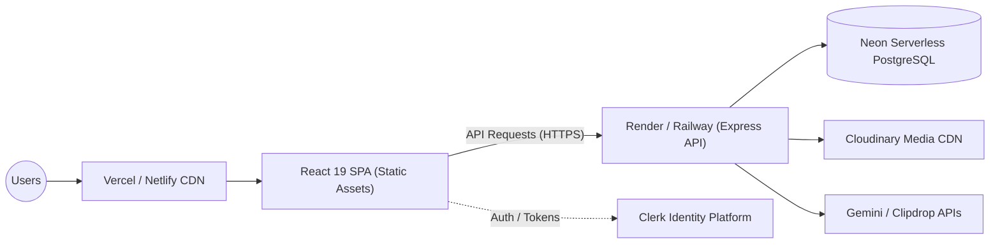

# QuickAI Deployment Guide

This guide describes how to deploy **QuickAI** to production environments, separating the React frontend and Express backend for high availability, low latency, and cost efficiency.

---

## 1. Production Architecture Overview



---

## 2. Deploying the Backend (`/server`)

The backend is a Node.js Express 5.x service and can be deployed to platforms like **Render**, **Railway**, or **AWS App Runner**.

### 2.1 Deployment on Render
1. Create a new **Web Service** on [Render](https://render.com).
2. Connect your Git repository.
3. Configure the service settings:
   - **Root Directory**: `server`
   - **Environment**: `Node`
   - **Build Command**: `npm install`
   - **Start Command**: `npm start`
   - **Instance Type**: Starter / Standard
4. Add the following **Environment Variables**:
   | Variable | Value Description |
   |---|---|
   | `PORT` | `3000` (or Render's default assigned port) |
   | `DATABASE_URL` | Neon PostgreSQL connection string with `?sslmode=require` |
   | `CLERK_PUBLISHABLE_KEY` | Production Clerk Publishable Key (`pk_live_...`) |
   | `CLERK_SECRET_KEY` | Production Clerk Secret Key (`sk_live_...`) |
   | `GEMINI_API_KEY` | Google Gemini API Key from Google AI Studio |
   | `CLIPDROP_API_KEY` | Clipdrop API Key |
   | `CLOUDINARY_CLOUD_NAME` | Cloudinary Cloud Name |
   | `CLOUDINARY_API_KEY` | Cloudinary API Key |
   | `CLOUDINARY_API_SECRET` | Cloudinary API Secret |
5. Click **Deploy**. Note the assigned URL (e.g., `https://quickai-api.onrender.com`).

---

## 3. Deploying the Frontend (`/client`)

The frontend is a Vite-based Single Page Application (SPA) that compiles to static assets (`dist/`), ideal for hosting on **Vercel**, **Netlify**, or **Cloudflare Pages**.

### 3.1 Deployment on Vercel
1. Import your Git repository into [Vercel](https://vercel.com).
2. Configure project settings:
   - **Framework Preset**: `Vite`
   - **Root Directory**: `client`
   - **Build Command**: `npm run build`
   - **Output Directory**: `dist`
   - **Install Command**: `npm install`
3. Add the **Environment Variables**:
   | Variable | Value |
   |---|---|
   | `VITE_CLERK_PUBLISHABLE_KEY` | Production Clerk Publishable Key (`pk_live_...`) |
   | `VITE_BASE_URL` | Your production backend URL (e.g., `https://quickai-api.onrender.com`) |
4. To handle client-side routing with React Router, create a `vercel.json` file in `client/` if needed:
   ```json
   {
     "rewrites": [{ "source": "/(.*)", "destination": "/index.html" }]
   }
   ```
5. Click **Deploy**.

---

## 4. Production Security & Service Configuration

### 4.1 Clerk Production Settings
1. In your Clerk Dashboard, switch from **Development** to **Production** mode.
2. In **Paths & Redirects**, configure your production domain:
   - **Home URL**: `https://your-domain.com`
   - **Sign In URL**: `https://your-domain.com/` (or dedicated sign-in path)
   - **After Sign In / Sign Up URL**: `https://your-domain.com/ai`

### 4.2 Database Health & SSL
- Always verify that `?sslmode=require` is appended to `DATABASE_URL`. Neon requires SSL for all external connections.
- Ensure the DDL script from [DATABASE.md](./DATABASE.md) has been executed on the production Neon database.

### 4.3 CORS Configuration
In `server/server.js`, `cors()` is configured with defaults. For strict production security, restrict origins to your frontend domain:
```javascript
app.use(cors({
  origin: process.env.CLIENT_URL || 'https://your-quickai-domain.com',
  credentials: true
}));
```

---

## 5. Pre-Launch Verification Checklist

- [ ] Backend health check responds with `Server is Live!` at `GET /`.
- [ ] Frontend successfully authenticates against Clerk in production mode.
- [ ] Users can generate articles and view outputs rendered in Markdown.
- [ ] Image generation connects to Clipdrop and uploads to Cloudinary without mixed-content errors.
- [ ] Community feed loads public creations and persists likes in PostgreSQL.
- [ ] Non-premium users are blocked from premium endpoints with appropriate error messages.
